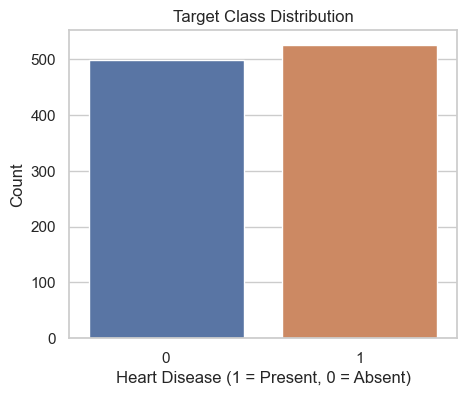
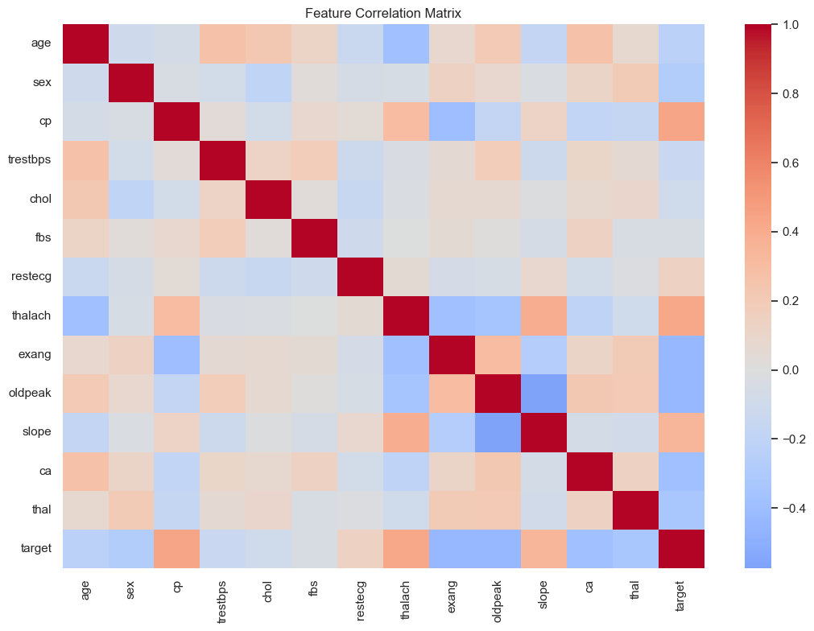
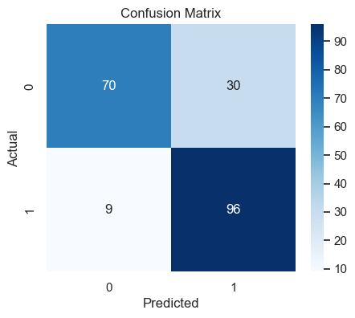
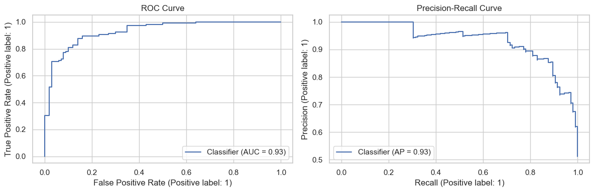
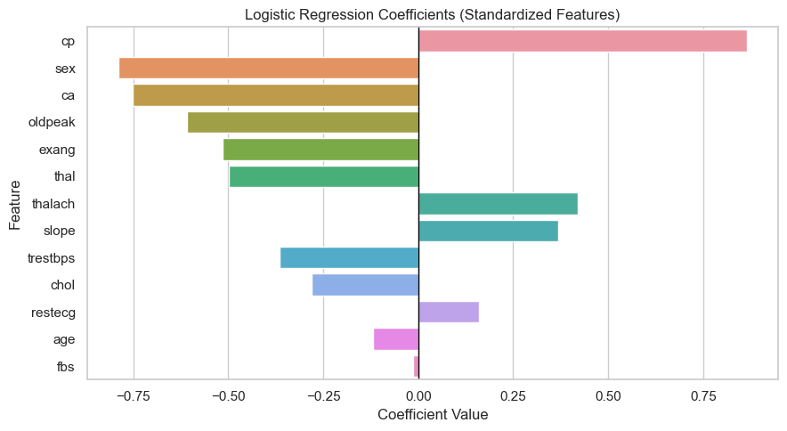

# Diagram Explanations and Meaning

This document explains each diagram generated from the heart disease notebook and what each one means in practical terms.

## Figure 1 - Target Class Distribution

This chart shows how many records belong to each target class (heart disease absent vs present).  
What it means:
- It indicates whether the dataset is balanced or imbalanced.
- If one class dominates, model training can become biased toward that class.
- This is why class-aware handling (for example balanced weighting) is important during training.

## Figure 2 - Correlation Heatmap

This heatmap displays pairwise relationships between numeric variables, including the target.  
What it means:
- Stronger colors indicate stronger relationships (positive or negative).
- It helps identify which predictors move together with heart disease outcome.
- It also reveals feature pairs that are highly related to each other, which can affect interpretation.

## Figure 3 - Confusion Matrix

This matrix breaks predictions into correct and incorrect classes.  
What it means:
- Diagonal cells represent correct predictions.
- Off-diagonal cells represent errors (false positives and false negatives).
- It shows what type of mistakes the model makes, not just how many.

## Figure 4 - ROC Curve

This curve compares true positive rate against false positive rate across thresholds.  
What it means:
- A curve closer to the top-left indicates better discrimination.
- The area under this curve (AUC) summarizes overall separability.
- If the curve stays well above the diagonal baseline, performance is meaningfully better than random guessing.

## Figure 5 - Logistic Regression Coefficients

This bar chart shows the sign and magnitude of model coefficients for each feature.  
What it means:
- Positive coefficients increase predicted heart disease likelihood.
- Negative coefficients reduce predicted heart disease likelihood.
- Larger absolute values indicate stronger influence on prediction.
- This makes the model interpretable and easier to justify in practical use.

## Overall Interpretation

Taken together, the diagrams show a complete story:
- the data distribution is understood,
- feature relationships are visible,
- predictive performance is quantified,
- error behavior is transparent, and
- feature influence is explainable.

In short, these diagrams demonstrate both model performance and interpretability, which is essential for trustworthy clinical decision support.
